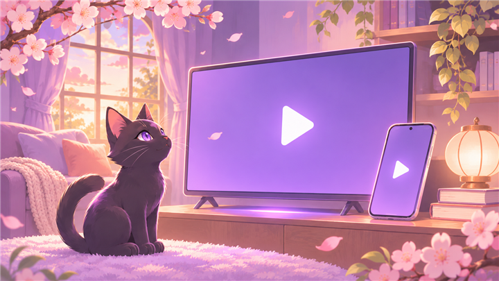

# Meowoo · Android / TV 播放器

Meowoo 是面向 Android 手机与电视的播放器项目，目前处于开发阶段。上图为项目插画，实际界面以应用为准。

## 项目与安装包

[Meowoo 项目仓库](https://github.com/Meowopia/Meowoo)提供公开项目信息。测试安装包与正式发布包请按项目维护者公布的入口获取；本页不提供未经确认的下载链接。

## OO 账号与云同步

支持相关功能的测试版本可通过 OO 账号进行登录授权。请从应用内部发起登录，在 OO 页面完成后返回应用。

云同步服务已经接入独立存储与 OO 授权校验。服务可访问不等于所有手机或电视版本均已完成端到端验收；同步功能以当前安装版本的说明和实际可用状态为准。

同步不等于上传媒体文件。不要把敏感链接、访问凭据或个人密钥放进公开反馈；可同步内容以应用提供的设置与确认项为准。

## 遇到问题

反馈时说明设备类型、Android 版本、应用版本和复现步骤。不要提交密码、验证码或授权令牌。可以到[社区与帮助](community.md)查看反馈入口。
